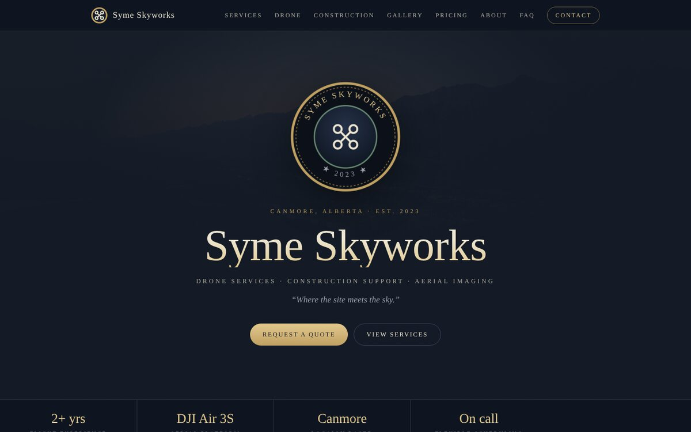
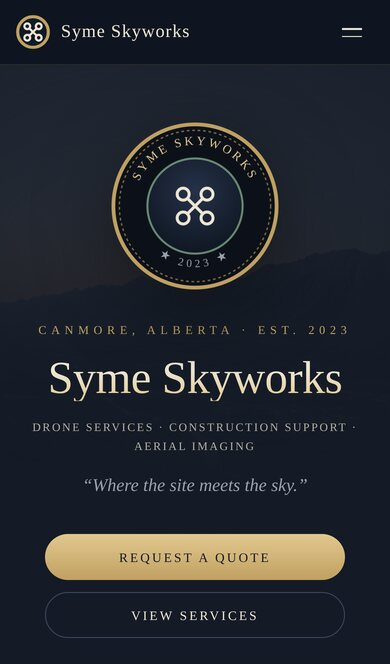

<p align="center">
  
</p>

<h1 align="center">Syme Skyworks</h1>

<p align="center">
  <em>Where the site meets the sky.</em><br>
  Drone services and construction support · Canmore, Alberta · Est. 2023
</p>

<p align="center">
  <a href="https://mcsyme11-byte.github.io/SymeSkyWorks/"><strong>Visit the website →</strong></a>
</p>

---

<p align="center">
  
</p>

## About the business

Syme Skyworks is a locally owned contracting and drone services company in Canmore, Alberta, founded in 2023 and operated by **Malcolm Syme**. It combines two kinds of work:

| In the air | On the ground |
|---|---|
| Drone inspections of structures, rooftops and hard-to-reach areas | General construction labour and site support |
| Aerial surveys, mapping and construction progress monitoring | Log stripping and yurt builds |
| Aerial photography and 4K video for real estate, marketing and events | Foundation assistance and power tool work |
| Flown with a DJI Air 3S, with 2+ years of flight experience | Material runs and on-call help |

Service area: Canmore, the 3 Sisters area and the Bow Valley.

## The website

<table>
  <tr>
    <td width="68%"></td>
    <td rowspan="2" valign="top"></td>
  </tr>
  <tr>
    <td></td>
  </tr>
</table>

**Highlights**

- **Mission patch logo** in the hero, top bar, footer, favicon and phone home-screen icon, with a simplified version for small sizes.
- **Shared design** with Malcolm Syme's other projects: navy, brass and cream, Georgia serif type, thin brass rules.
- **Fast:** no frameworks, no build step and no web fonts; photos load lazily from 720 px thumbnails.
- **Works everywhere:** one column on phones, two on tablets, three on desktops. Respects "reduce motion" and is fully keyboard-accessible.
- **Gallery viewer:** select any aerial photo to enlarge it.
- **Contact form** sent through Formspree, plus direct email and phone links.
- **Ready to share:** page description, share image, favicons, web app manifest, sitemap and a matching "page not found" page.

**Sections:** Services · Drone Services · Construction Support · Gallery · Pricing · About & Equipment · FAQ · Contact

## Repository layout

```
├── index.html              The website (one page)
├── 404.html                "Page not found" page
├── assets/
│   ├── style.css           All styling (colour tokens at the top)
│   ├── site.js             Phone menu, reveal-on-scroll, gallery viewer
│   ├── icons/              Favicons and app icons
│   └── img/                Photos, thumb/ (720 px), web patch, share image
├── brand/
│   ├── patch/              Full mission patch (SVG + 1024 px PNG)
│   ├── mark/               Simplified marks for small sizes
│   └── README.md           Logo usage rules
├── docs/
│   ├── DESIGN.md           Design guide: colours, type, layout, logo placement
│   ├── HISTORY.md          How the business and site got here
│   ├── screenshots/        Images used in this README
│   └── handoffs/           Notes for other project chats
├── site.webmanifest        Name, colours and icons for "Add to Home Screen"
├── robots.txt, sitemap.xml For search engines
├── CHANGELOG.md            Dated list of changes
└── LICENSE                 Copyright notice (all rights reserved)
```

## Updating the site

Everything is plain HTML, CSS and JavaScript. Edit, commit to `main`, and GitHub Pages publishes it within a minute or two.

| To change | Edit |
|---|---|
| Services, prices, FAQ, contact details | Text in `index.html` (each section is labelled by its `id`, e.g. `id="pricing"`) |
| Colours, spacing, fonts | The tokens at the top of `assets/style.css` |
| Add a gallery photo | Put the full photo in `assets/img/` and a 720 px copy in `assets/img/thumb/`, then copy one `<figure class="shot">` block in the gallery |
| The logo | See [`brand/README.md`](brand/README.md) |

After changing `style.css` or `site.js`, bump the `?v=` number on their links at the top and bottom of `index.html` (for example `?v=20261117a` → `?v=20261118a`) so visitors get the new version instead of an old cached copy. Record notable changes in [`CHANGELOG.md`](CHANGELOG.md).

## Brand

The **Syme Skyworks mission patch** is the main logo. Use the full patch at 64 px and larger, and the text-free marks below that. Full rules, files and sizes are in [`brand/README.md`](brand/README.md) and [`docs/DESIGN.md`](docs/DESIGN.md).

| Full patch | Mark (32–64 px) | Small mark (under 32 px) |
|:---:|:---:|:---:|
|  |  |  |

## Contact

**Malcolm Syme**, Founder and President
✉️ [mcsyme11@gmail.com](mailto:mcsyme11@gmail.com) · ☎️ +1 (403) 679-1495
🌐 [mcsyme11-byte.github.io/SymeSkyWorks](https://mcsyme11-byte.github.io/SymeSkyWorks/)

---

<p align="center">
  © 2026 Malcolm Syme · mcsyme11@gmail.com · All rights reserved.<br>
  Syme Skyworks™ and the Syme Skyworks mission patch are trademarks of Malcolm Syme.<br>
  Photographs © Malcolm Syme. See <a href="LICENSE">LICENSE</a>.
</p>
