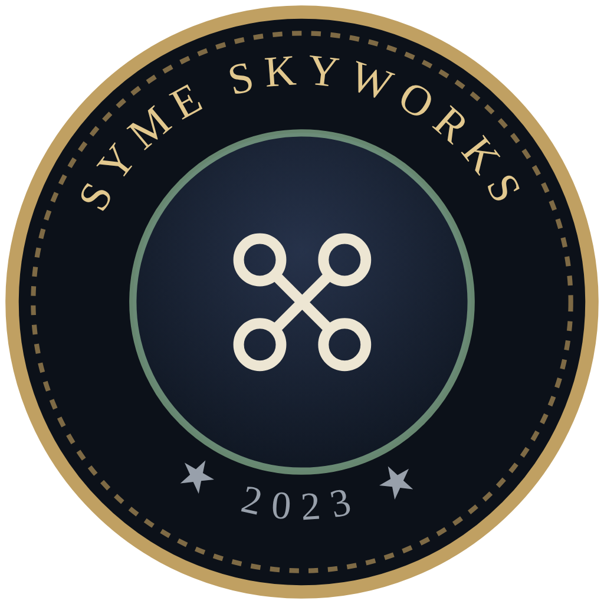
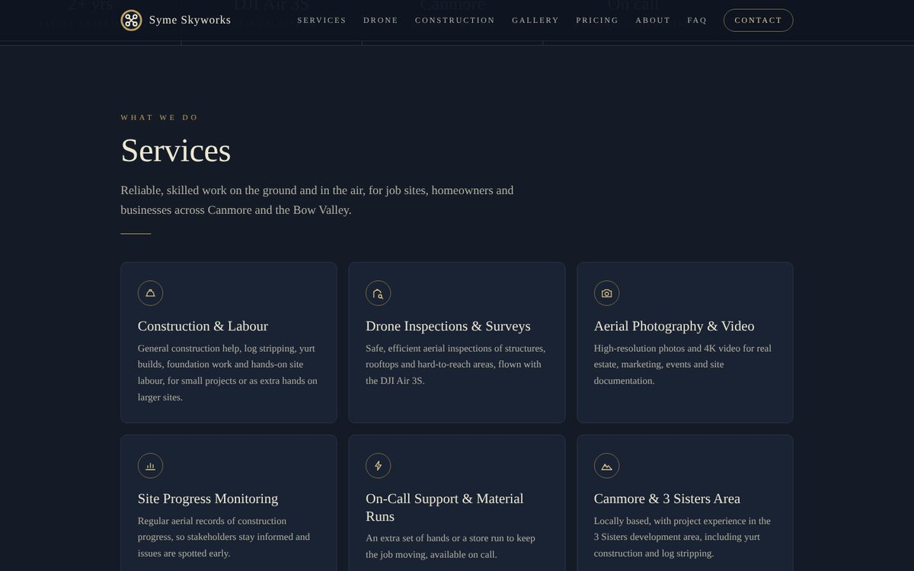
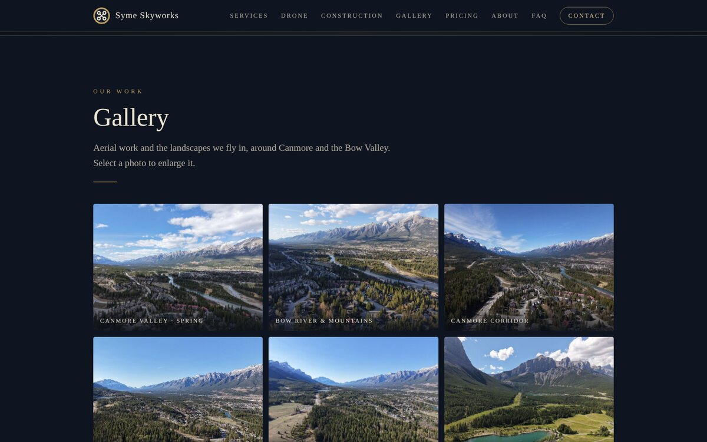

<p align="center">
  
</p>

<h1 align="center">Syme Skyworks</h1>

<p align="center">
  <em>Where the site meets the sky.</em><br>
  Drone services and construction support · Canmore, Alberta · Est. 2023
</p>

<p align="center">
  <a href="https://mcsyme11-byte.github.io/SymeSkyWorks/"><strong>Visit the website →</strong></a>
</p>

---

<p align="center">
  
</p>

## About the business

Syme Skyworks is a locally owned contracting and drone services company in Canmore, Alberta, founded in 2023 and operated by **Malcolm Syme**. It combines two kinds of work:

| In the air | On the ground |
|---|---|
| Drone inspections of structures, rooftops and hard-to-reach areas | General construction labour and site support |
| Aerial surveys, mapping and construction progress monitoring | Log stripping and yurt builds |
| Aerial photography and 4K video for real estate, marketing and events | Foundation assistance and power tool work |
| Flown with a DJI Air 3S, with 2+ years of flight experience | Material runs and on-call help |

**IT support (our specialty):** computer setup, repairs, Wi-Fi and networks, security, backups, printers, software and phones for homes and small businesses in Canmore and Banff.

**On Charles Carey (seasonal):** snow shoveling in winter (driveways from $16 per visit, after 2 cm+ snowfalls) and landscaping in summer (mowing, weeding, yard cleanup; free quotes), with sign-up and pre-season registration on the site.

Service areas: IT support in Canmore and Banff; drone and construction work across Canmore; snow shoveling and landscaping on Charles Carey.

## The website

<table>
  <tr>
    <td width="68%"></td>
    <td rowspan="2" valign="top"></td>
  </tr>
  <tr>
    <td></td>
  </tr>
</table>

**Highlights**

- **Mission patch logo** in the hero, top bar, footer, favicon and phone home-screen icon, with a simplified version for small sizes.
- **Shared design** with Malcolm Syme's other projects: navy, brass and cream, Georgia serif type, thin brass rules.
- **Fast:** no frameworks, no build step and no web fonts; photos load lazily from 720 px thumbnails.
- **Works everywhere:** one column on phones, two on tablets, three on desktops. Respects "reduce motion" and is fully keyboard-accessible.
- **Gallery viewer:** select any aerial photo to enlarge it.
- **Seasonal sign-ups:** snow shoveling and landscaping tabs, a service-area map, a sign-up / pre-registration form, and a pop-up that switches with the season.
- **Contact form** sent through Formspree, plus direct email and phone links.
- **Ready to share:** page description, share image, favicons, web app manifest, sitemap and a matching "page not found" page.

**Sections:** Services · Drone Services · Construction Support · Gallery · Pricing · About & Equipment · FAQ · Contact

## Pages

| Page | What's on it |
|---|---|
| `index.html` | Home: hero, IT Support and Snow Shoveling feature cards, all services, photo preview |
| `it.html` | IT Support (our specialty), about $35 per hour, Canmore and Banff |
| `snow.html` | Snow shoveling and landscaping on Charles Carey: map, sign-up and pre-season form |
| `drone.html`, `construction.html` | Drone services and construction support |
| `gallery.html` | Aerial photo gallery with viewer |
| `pricing.html`, `about.html`, `faq.html`, `contact.html` | Rates, company, questions, contact form |
| `privacy.html`, `terms.html` | Privacy Policy (Alberta PIPA) and Terms of Service |

## Repository layout

```
├── src/
│   ├── pages/              Content of each page (edit these)
│   └── partials/           Shared header + menu, footer, icons, seasonal pop-up
├── tools/build.py          Builds the pages from src/ (python3 tools/build.py)
├── *.html                  Generated pages served by GitHub Pages (don't edit directly)
├── 404.html                "Page not found" page
├── assets/
│   ├── style.css           All styling (colour tokens at the top)
│   ├── site.js             Menu, dropdown, reveal, gallery viewer, seasonal tabs/map/form, pop-up
│   ├── vendor/leaflet/     Map library (Leaflet 1.9.4, BSD-2 licence)
│   ├── icons/              Favicons and app icons
│   └── img/                Photos, thumb/ (720 px), web patch, share image
├── brand/                  Logo: mission patch, marks, social preview ([brand/README.md](brand/README.md))
├── docs/                   Design guide, history, screenshots, hand-offs
├── site.webmanifest, robots.txt, sitemap.xml
├── CHANGELOG.md
└── LICENSE                 Copyright notice (all rights reserved)
```

## Updating the site

1. Edit the page in `src/pages/` (or the shared menu/footer in `src/partials/`).
2. Run `python3 tools/build.py`.
3. Commit everything to `main`; GitHub Pages publishes within a minute or two.

After changing `assets/style.css` or `assets/site.js`, bump `VERSION` in `tools/build.py` before building so visitors get the new files. Record notable changes in [`CHANGELOG.md`](CHANGELOG.md).

## Brand

The **Syme Skyworks mission patch** is the main logo. Use the full patch at 64 px and larger, and the text-free marks below that. Full rules, files and sizes are in [`brand/README.md`](brand/README.md) and [`docs/DESIGN.md`](docs/DESIGN.md).

| Full patch | Mark (32–64 px) | Small mark (under 32 px) |
|:---:|:---:|:---:|
|  |  |  |

## Contact

**Malcolm Syme**, Founder and President
✉️ [mcsyme11@gmail.com](mailto:mcsyme11@gmail.com) · ☎️ +1 (403) 679-1495
🌐 [mcsyme11-byte.github.io/SymeSkyWorks](https://mcsyme11-byte.github.io/SymeSkyWorks/)

---

<p align="center">
  © 2026 Malcolm Syme · mcsyme11@gmail.com · All rights reserved.<br>
  Syme Skyworks™ and the Syme Skyworks mission patch are trademarks of Malcolm Syme.<br>
  Photographs © Malcolm Syme. See <a href="LICENSE">LICENSE</a>.
</p>
